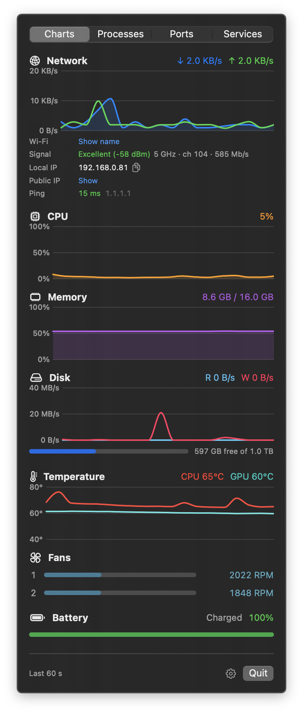
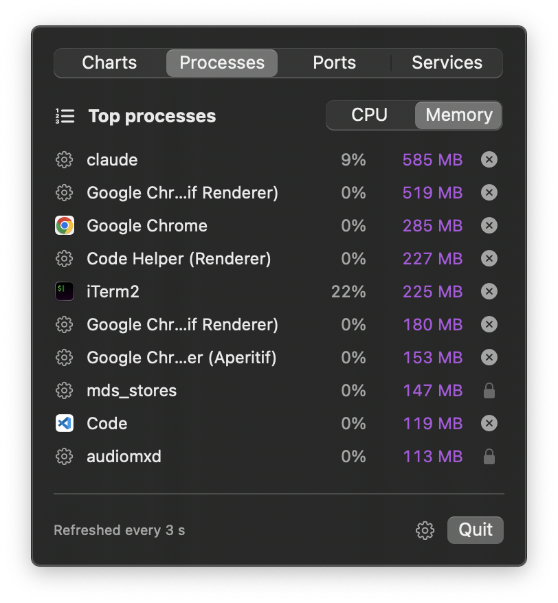
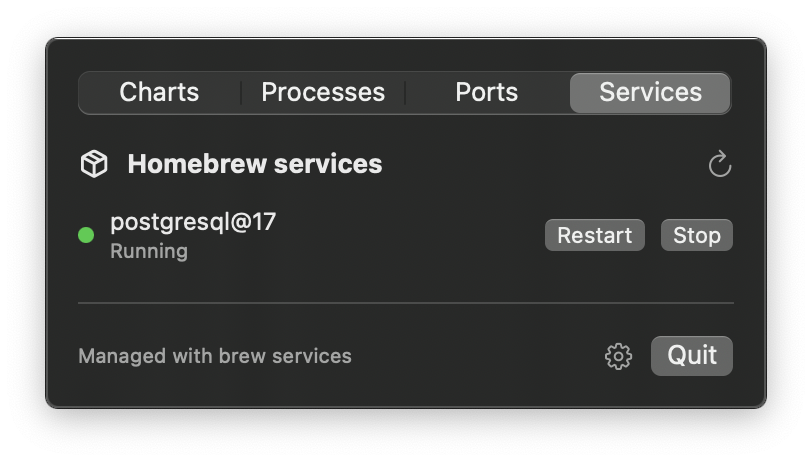
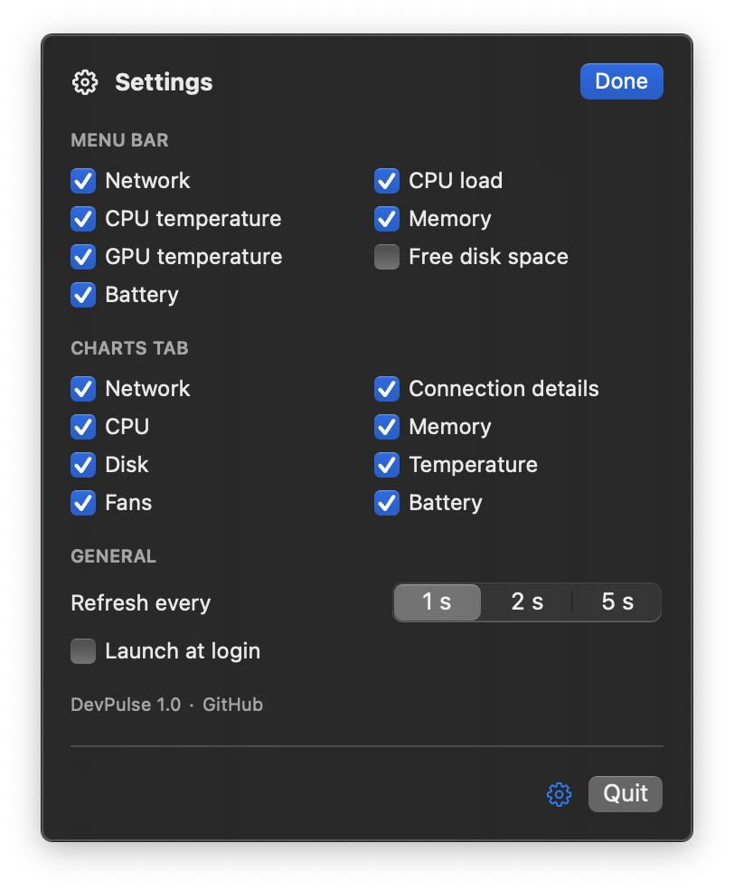

<div align="center">

# DevPulse

**A lightweight macOS menu bar monitor for developers.**
Network, CPU, memory, temperatures, fans and battery at a glance, plus the processes and ports your dev servers are hogging.


</div>

---

## Screenshots

<table>
  <tr>
    <td align="center" valign="top"><br><sub><b>Charts</b>: live 60 s history</sub></td>
    <td align="center" valign="top"><br><sub><b>Processes</b>: what's eating your CPU and RAM</sub></td>
    <td align="center" valign="top"><br><sub><b>Ports</b>: which project owns which port</sub></td>
  </tr>
  <tr>
    <td align="center" valign="top"><br><sub><b>Services</b>: start and stop <code>brew services</code></sub></td>
    <td align="center" valign="top"><br><sub><b>Settings</b>: pick what you see</sub></td>
    <td></td>
  </tr>
</table>

## Features

### 📊 Always-visible stats in the menu bar
Download and upload speed, CPU load and temperature, memory usage, GPU temperature and battery level, each with its own icon. Numbers use fixed widths, so the menu bar doesn't jump around as values change.

### 📈 Live charts
Click the menu bar item to open 60-second charts for **network**, **CPU**, **memory**, **disk read/write** and **CPU/GPU temperature**, plus **free disk space**, **fan speeds** and **battery status** (charging, time remaining).

### 📶 Connection details
Below the network chart: Wi-Fi signal quality (dBm, band, channel, link speed), local IP, latency to `1.1.1.1`, and your public IP on request. Click any IP to copy it.

> macOS only reveals the **Wi-Fi network name** to apps with Location Services access. DevPulse asks for it only when you click *Show name*, and uses it for nothing else. The public IP is looked up via `api.ipify.org`, and only when you click *Show*.

### 🔥 Top processes
The 10 heaviest processes, sortable by **CPU** or **memory**, with app icons. Terminate a runaway process in two clicks: the first click arms the button, the second one confirms. GUI apps are quit gracefully, like ⌘Q.

### 🔌 Listening ports, made for developers
The reason this app exists. You get every listening TCP port **together with the project and framework behind it**, so instead of five anonymous `node` processes you see:

```
:3000   my-nuxt-app   [Nuxt]         node · ~/dev/my-nuxt-app
:5432   postgres      [PostgreSQL]
:8080   api-server    [Express]  🌐  node · ~/dev/api-server
```

- **Framework detection** from `package.json` (Nuxt, Next.js, SvelteKit, Astro, Remix, Angular, NestJS, Vite, Express…), plus Django, Flask, FastAPI, Rails, Laravel, Go and Rust projects, and services like PostgreSQL, MySQL, Redis and MongoDB
- **Open the project in your editor** with one click (VS Code, Cursor, Zed or Sublime Text, whichever is installed)
- **Right-click** a port to copy its URL or open the project in Terminal or Finder
- **Click a port** to open `http://localhost:<port>` in your browser
- **Kill a stale dev server** that's still holding a port, without hunting it down with `lsof`
- 🌐 marks services **exposed to your local network** (bound to `0.0.0.0`, not just `localhost`)
- macOS system services (AirPlay, Handoff…) are hidden by default

### 🍺 Homebrew services
See which `brew services` are running (PostgreSQL, Redis, MySQL…) and **start, stop or restart** them with one click, without remembering the exact formula name. The list is only refreshed while the tab is open.

### ⚙️ Settings
Press **⌘,** (or the gear icon) to choose which stats appear in the menu bar and which sections the Charts tab shows, set the refresh interval (1, 2 or 5 s) and turn on **launch at login**.

### 🪶 Lightweight and native
Written in Swift and SwiftUI, with no Electron and no dependencies. Processes and ports are only polled while the popover is open, so it costs next to nothing in the background. No Dock icon.

## Installation

DevPulse is currently distributed as source. Building takes about a minute and **does not require Xcode**; the Command Line Tools are enough.

```bash
# 1. Install the Command Line Tools (skip if you already have them)
xcode-select --install

# 2. Clone and build
git clone https://github.com/bartomiak/devpulse.git
cd devpulse
./build.sh release

# 3. Install
cp -R build/DevPulse.app /Applications/
open /Applications/DevPulse.app
```

**Start at login:** enable *Launch at login* in DevPulse's settings (⌘,).

## Compatibility

| | Intel Mac | Apple Silicon |
|---|:---:|:---:|
| Network, CPU, memory, battery | ✅ | ✅ |
| Processes and ports | ✅ | ✅ |
| CPU/GPU temperature, fans | ✅ | 🧪 *experimental* |

Release builds are **universal binaries**, so one app runs natively on both architectures.

**Temperatures on Apple Silicon** are read from the IOHIDEventSystem sensors (the CPU value is the average of the `pACC`/`eACC` core sensors, the GPU value is the average of the `GPU` sensors). If those aren't available, DevPulse falls back to known M1–M3 SMC keys. Fan speeds use the same SMC code as on Intel; fanless MacBook Airs simply hide the section.

> [!NOTE]
> I developed DevPulse on an Intel MacBook Pro, so **the Apple Silicon sensor code hasn't been tested on real hardware yet**. If you're on an M-series Mac, please run the command below and [open an issue](https://github.com/bartomiak/devpulse/issues/new) with the output, whether it works or not. Sensor names differ between chip generations, and your report helps get them right.
>
> ```bash
> /Applications/DevPulse.app/Contents/MacOS/DevPulse --sensors
> ```

Requires **macOS 13 Ventura** or later.

## Development

```bash
./run.sh               # debug build + restart the app
./build.sh release     # universal release build → build/DevPulse.app
build/DevPulse.app/Contents/MacOS/DevPulse --sensors   # print all detected sensors
```

VS Code users can press `⇧⌘B` to run the **Build & Run** task. Install the recommended [Swift extension](https://marketplace.visualstudio.com/items?itemName=swiftlang.swift-vscode) for autocompletion.

<details>
<summary><b>Project structure</b></summary>

| File | Purpose |
|---|---|
| `Sources/DevPulse/DevPulseApp.swift` | `MenuBarExtra` and the menu bar label |
| `Sources/DevPulse/ContentView.swift` | Popover with tabs and charts |
| `Sources/DevPulse/Monitor.swift` | 1 s sampling loop, history, formatting |
| `Sources/DevPulse/Sensors.swift` | CPU, network, memory, battery and temperature readers |
| `Sources/DevPulse/Thermal.swift` | Picks the temperature source (HID on Apple Silicon, SMC on Intel), `--sensors` report |
| `Sources/DevPulse/Fans.swift` | Fan speeds (SMC) |
| `Sources/DevPulse/Processes.swift` | Top processes (`ps`), listening ports (`lsof`), terminating processes |
| `Sources/DevPulse/ProcessViews.swift` | Processes and Ports tabs |
| `Sources/DevPulse/Projects.swift` | Project and framework detection, opening projects in the editor |
| `Sources/DevPulse/BrewServices.swift` | Services tab (`brew services`) |
| `Sources/DevPulse/NetworkInfo.swift` | Wi-Fi details, IP addresses and ping |
| `Sources/DevPulse/Disk.swift` | Disk throughput and free space |
| `Sources/DevPulse/Settings.swift` | Settings panel, preferences and launch at login |
| `Sources/CSMC/` | AppleSMC and IOHIDEventSystem sensor access, written in C |

</details>

<details>
<summary><b>How it works</b></summary>

| Metric | Source |
|---|---|
| CPU | `host_statistics(HOST_CPU_LOAD_INFO)` tick deltas |
| Network | 64-bit interface counters via `sysctl(NET_RT_IFLIST2)`, summed over `en*` interfaces |
| Memory | `host_statistics64(HOST_VM_INFO64)`, computed like Activity Monitor (app + wired + compressed) |
| Disk | `IOBlockStorageDriver` statistics for read/write, volume resource values for free space |
| Battery | IOKit power sources (`IOPSCopyPowerSourcesInfo`) |
| Temperatures (Intel) | AppleSMC via `IOConnectCallStructMethod` |
| Temperatures (Apple Silicon) | `IOHIDEventSystemClient` temperature sensors, with SMC fallback |
| Fans | AppleSMC (`F<n>Ac`, `F<n>Mn`, `F<n>Mx`) |
| Processes | `ps`, polled only while the popover is open |
| Ports | `lsof` plus `proc_pidinfo` for each process's working directory |

The menu bar label is rendered into a single template image, because `MenuBarExtra` drops SF Symbols embedded in text. macOS then tints it correctly for light and dark menu bars.

</details>

## The story

I built DevPulse for myself. I wanted to see what my Intel MacBook Pro was doing without opening Activity Monitor: why the fans were spinning up, what was eating my RAM, and above all **which forgotten dev server was still sitting on port 3000**.

The whole app was built with **[Claude Code](https://claude.com/claude-code)**, Anthropic's agentic coding tool, through a conversation in my terminal. I started from "I'd like a menu bar app with network, CPU and temperature charts" and added features as I needed them: memory and battery, menu bar icons, fan speeds, processes, and finally the ports tab. Claude wrote the Swift and C code, tested it against my actual hardware (probing which SMC sensor keys my Mac exposes) and took the screenshots you see above.

It turned out useful enough that I'm sharing it. I hope it helps you too.

## License

[MIT](LICENSE)
