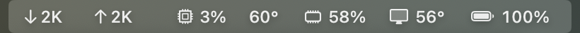
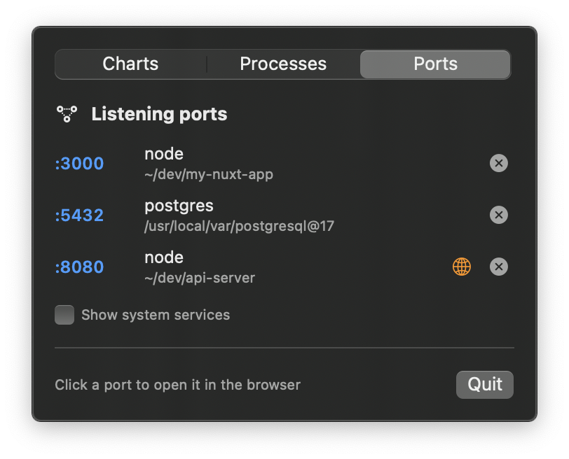

<div align="center">

# DevPulse

**A lightweight macOS menu bar monitor for developers.**
Network, CPU, memory, temperatures, fans and battery at a glance, plus the processes and ports your dev servers are hogging.




</div>

---

## Screenshots

<table>
  <tr>
    <td align="center"><br><sub><b>Charts</b>: live 60 s history</sub></td>
    <td align="center"><br><sub><b>Processes</b>: what's eating your CPU and RAM</sub></td>
    <td align="center"><br><sub><b>Ports</b>: which project owns which port</sub></td>
  </tr>
</table>

## Features

### 📊 Always-visible stats in the menu bar
Download and upload speed, CPU load and temperature, memory usage, GPU temperature and battery level, each with its own icon. Numbers use fixed widths, so the menu bar doesn't jump around as values change.

### 📈 Live charts
Click the menu bar item to open 60-second charts for **network**, **CPU**, **memory** and **CPU/GPU temperature**, plus **fan speeds** and **battery status** (charging, time remaining).

### 🔥 Top processes
The 10 heaviest processes, sortable by **CPU** or **memory**, with app icons. Terminate a runaway process in two clicks: the first click arms the button, the second one confirms. GUI apps are quit gracefully, like ⌘Q.

### 🔌 Listening ports, made for developers
The reason this app exists. You get every listening TCP port **together with the working directory of the process**, so instead of five anonymous `node` processes you see:

```
:3000   node   ~/dev/my-nuxt-app
:8080   node   ~/dev/api-server     🌐
```

- **Click a port** to open `http://localhost:<port>` in your browser
- **Kill a stale dev server** that's still holding a port, without hunting it down with `lsof`
- 🌐 marks services **exposed to your local network** (bound to `0.0.0.0`, not just `localhost`)
- macOS system services (AirPlay, Handoff…) are hidden by default

### 🪶 Lightweight and native
Written in Swift and SwiftUI, with no Electron and no dependencies. Processes and ports are only polled while the popover is open, so it costs next to nothing in the background. No Dock icon.

## Installation

DevPulse is currently distributed as source. Building takes about a minute and **does not require Xcode**; the Command Line Tools are enough.

```bash
# 1. Install the Command Line Tools (skip if you already have them)
xcode-select --install

# 2. Clone and build
git clone https://github.com/<your-username>/devpulse.git
cd devpulse
./build.sh release

# 3. Install
cp -R build/DevPulse.app /Applications/
open /Applications/DevPulse.app
```

**Start at login:** *System Settings → General → Login Items → +* → select DevPulse.

## Compatibility

| | Intel Mac | Apple Silicon |
|---|:---:|:---:|
| Network, CPU, memory, battery | ✅ | ✅ |
| Processes and ports | ✅ | ✅ |
| CPU/GPU temperature, fans | ✅ | ❌ *(not yet)* |

Temperatures and fan speeds come from the SMC, and Apple Silicon uses different sensor keys. I built DevPulse on an Intel MacBook Pro, so that's what it supports today. **Pull requests adding Apple Silicon sensors are very welcome!**

Requires **macOS 13 Ventura** or later.

## Development

```bash
./run.sh               # debug build + restart the app
./build.sh release     # release build → build/DevPulse.app
```

VS Code users can press `⇧⌘B` to run the **Build & Run** task. Install the recommended [Swift extension](https://marketplace.visualstudio.com/items?itemName=swiftlang.swift-vscode) for autocompletion.

<details>
<summary><b>Project structure</b></summary>

| File | Purpose |
|---|---|
| `Sources/DevPulse/DevPulseApp.swift` | `MenuBarExtra` and the menu bar label |
| `Sources/DevPulse/ContentView.swift` | Popover with tabs and charts |
| `Sources/DevPulse/Monitor.swift` | 1 s sampling loop, history, formatting |
| `Sources/DevPulse/Sensors.swift` | CPU, network, memory, battery and temperature readers |
| `Sources/DevPulse/Fans.swift` | Fan speeds (SMC) |
| `Sources/DevPulse/Processes.swift` | Top processes (`ps`), listening ports (`lsof`), terminating processes |
| `Sources/DevPulse/ProcessViews.swift` | Processes and Ports tabs |
| `Sources/CSMC/` | AppleSMC access, written in C |

</details>

<details>
<summary><b>How it works</b></summary>

| Metric | Source |
|---|---|
| CPU | `host_statistics(HOST_CPU_LOAD_INFO)` tick deltas |
| Network | 64-bit interface counters via `sysctl(NET_RT_IFLIST2)`, summed over `en*` interfaces |
| Memory | `host_statistics64(HOST_VM_INFO64)`, computed like Activity Monitor (app + wired + compressed) |
| Battery | IOKit power sources (`IOPSCopyPowerSourcesInfo`) |
| Temperatures, fans | AppleSMC via `IOConnectCallStructMethod` |
| Processes | `ps`, polled only while the popover is open |
| Ports | `lsof` plus `proc_pidinfo` for each process's working directory |

The menu bar label is rendered into a single template image, because `MenuBarExtra` drops SF Symbols embedded in text. macOS then tints it correctly for light and dark menu bars.

</details>

## The story

I built DevPulse for myself. I wanted to see what my Intel MacBook Pro was doing without opening Activity Monitor: why the fans were spinning up, what was eating my RAM, and above all **which forgotten dev server was still sitting on port 3000**.

The whole app was built with **[Claude Code](https://claude.com/claude-code)**, Anthropic's agentic coding tool, through a conversation in my terminal. I started from "I'd like a menu bar app with network, CPU and temperature charts" and added features as I needed them: memory and battery, menu bar icons, fan speeds, processes, and finally the ports tab. Claude wrote the Swift and C code, tested it against my actual hardware (probing which SMC sensor keys my Mac exposes) and took the screenshots you see above.

It turned out useful enough that I'm sharing it. I hope it helps you too.

## Contributing

Issues and pull requests are welcome, especially for:

- Apple Silicon temperature and fan sensors
- A settings panel (choose which stats appear in the menu bar)
- Notifications (e.g. CPU temperature above a threshold)
- Signed and notarized releases

## License

[MIT](LICENSE)
